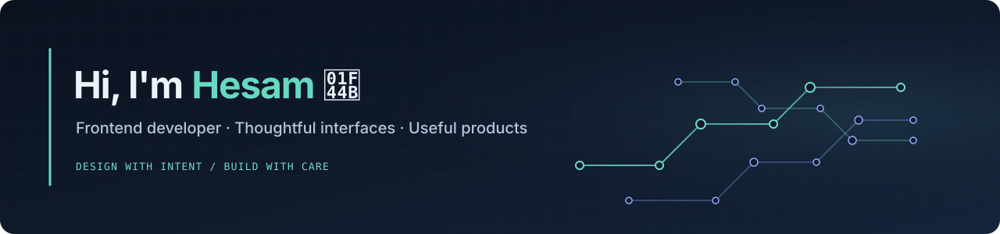

  

  <a href="https://github.com/hesaaam?tab=repositories">Explore my repositories</a>
  &nbsp;·&nbsp;
  <a href="https://github.com/hesaaam/hesaaam.github.io">Portfolio source</a>

## About

I'm a frontend developer who enjoys turning product ideas into clear, dependable interfaces. Lately, I've been building a local-first Android connection navigator and exploring confidence-aware AI experiences.

## Selected work

### [Hesam Void](https://github.com/hesaaam/hesam-void)
A local-first Android connection navigator for user-owned VPN and SSH profiles, with explainable route health and privacy-conscious on-device data handling.

### [Signal Garden](https://github.com/hesaaam/signal-garden-typesafe)
An interactive landing page showing how TypeSafe AI can turn unstructured product copy into actionable, confidence-aware decisions.

### [MovieApp](https://github.com/hesaaam/MovieApp)
A lightweight movie-browsing interface built with Vite, Alpine.js, Tailwind CSS, vanilla JavaScript and Sass.

### [Portfolio](https://github.com/hesaaam/hesaaam.github.io)
A home for my frontend work and experiments.

## Tools I work with

`JavaScript` · `TypeScript` · `Dart` · `React` · `Next.js` · `Alpine.js` · `Vite` · `Tailwind CSS` · `HTML` · `CSS / SCSS`

---

  Building useful things, one thoughtful interface at a time.

